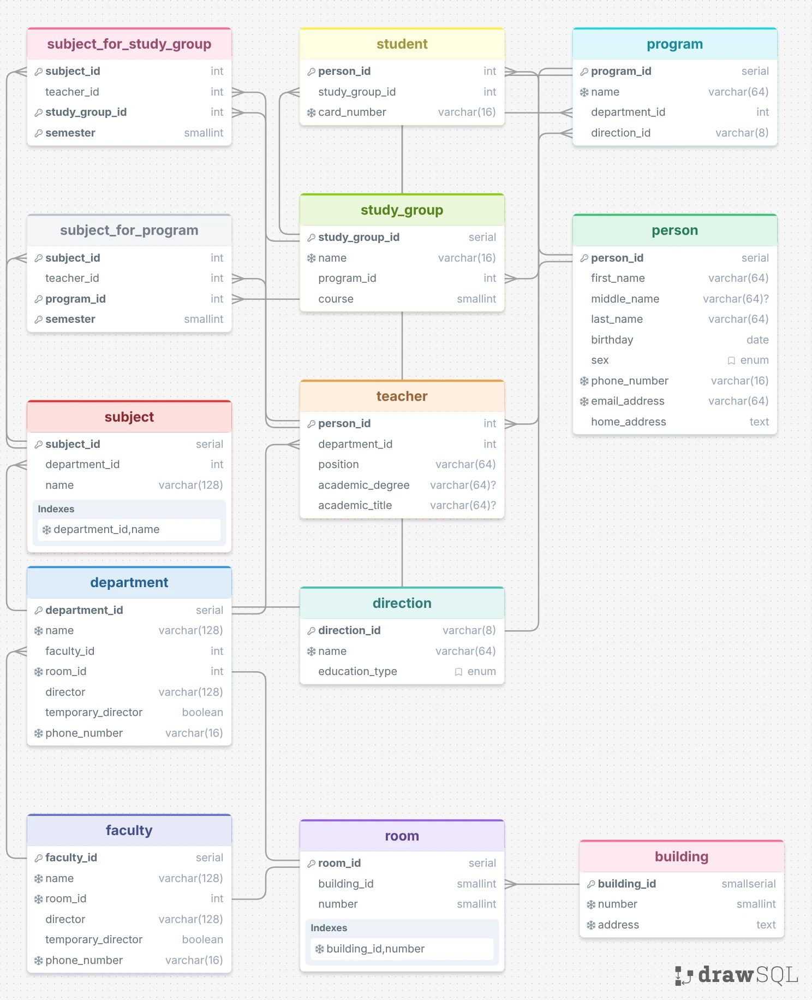

# Лабораторная работа 1. Проектирование и реализация реляционной базы данных

## Задание
По выданному варианту предметной области необходимо:
1. Выделить основные сущности, их атрибуты и связи.
2. Спроектировать реляционную модель данных, приведенную к 3НФ.
3. Построить ER-диаграмму с указанием:
  - таблиц и основных атрибутов;
  - первичных и внешних ключей;
  - связей.
4. Реализовать спроектированную БД в PostgreSQL.
5. Заполнить БД тестовыми данными.
6. Продемонстрировать работу ограничений целостности.

## Требования к базе данных
База данных должна содержать:
- не менее 5 содержательных таблиц;
- не менее 2 ограничений `UNIQUE`;
- не менее 3 ограничений `CHECK`;
- не менее одного составного ограничения;
- `NOT NULL` для обязательных атрибутов;

Необходимо использовать подходящие типы данных PostgreSQL. Выбор типов данных, ключей
и правил `ON DELETE` должен соответствовать предметной области.

## Тестовые данные
База должна содержать достаточное количество данных для проверки всех связей и ограничений.

Необходимо подготовить минимум 5 некорректных операций `INSERT`/`UPDATE`,
которые отклоняются PostgreSQL из-за созданных ограничений целостности.

## Изменение требований
После реализации исходной модели преподаватель выдаёт дополнительное изменение
предметной области.

Это отдельная часть задания, которую можно будет сдавать отдельно, после прохождения этого материала.

Необходимо изменить существующую структуру БД с использованием DDL
(`ALTER TABLE`, добавление/изменение ограничений и т.п.).

Пересоздание базы данных не допускается. Существующие данные должны быть сохранены.

## Вариант предметной области
3. Информационная система университета.

Конкретный состав сущностей, атрибутов и связей студент определяет самостоятельно исходя из предметной области.

Студент должен уметь объяснить назначение любого элемента представленного им SQL-кода.

Студент предоставляет:
- краткое описание предметной области;
- ER-диаграмму;
- описание основных проектных решений;
- обоснование приведения модели к 3НФ;
- [schema.sql](./schema.sql) — создание структуры БД;
- [data.sql](./data.sql) — тестовые данные;
- [constraints_test.sql](./constraints_test.sql) — проверка ограничений;
- [migration.sql](./migration.sql) — изменение структуры по дополнительному требованию.

---

## ER-диаграмма

(здесь будет описание предметной области, описание основных проектных решений и обоснование приведения модели к 3НФ)

- проверить все свойства на ограничения
- подумать где можно заменить типы данных на большие или меньшие (например, smallserial вместо serial)
- подумать об объединении свойств кафедры и факультета